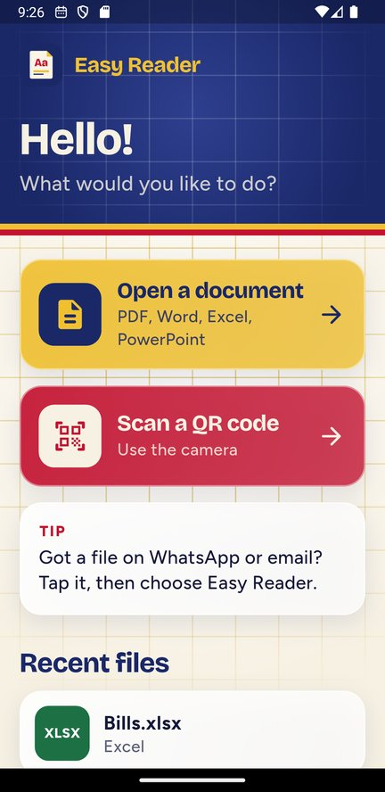
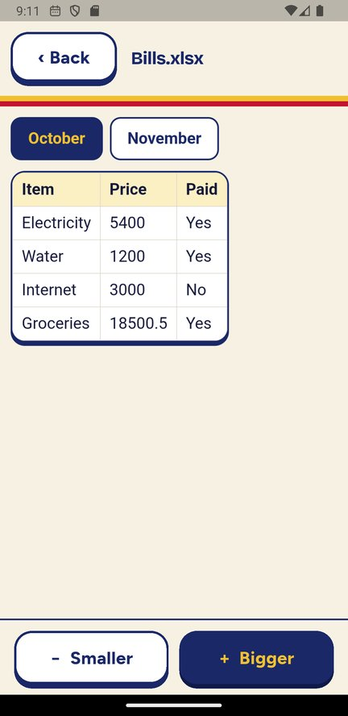

# Easy Reader

**A simple phone app for older people to open documents and scan QR codes, with big text and big buttons.**

## Download (Android)

| Phone | File |
| --- | --- |
| Most phones (2017 and newer) | **[EasyReader.apk](https://github.com/Sameeha0/easy-reader/raw/main/release/EasyReader.apk)** (19 MB) |
| Very old phones | **[EasyReader-older-phones.apk](https://github.com/Sameeha0/easy-reader/raw/main/release/EasyReader-older-phones.apk)** (16 MB) |

Both files are also in the [`release`](release) folder above and on the [Releases page](https://github.com/Sameeha0/easy-reader/releases/latest). Install steps are [below](#install-it-android).

<p>
  
  &nbsp;
  
</p>

## Why I made this

Lots of older people get documents on WhatsApp or by email: a doctor's letter, a bill, a trip plan. Opening them is harder than it should be. The phone asks which app to use, the text is tiny, there are icons with no words, and one wrong tap leads somewhere confusing.

Easy Reader does just two things and tries to make them impossible to get wrong:

1. **Open a document** (PDF, Word, Excel, PowerPoint)
2. **Scan a QR code**

## What makes it easy

- **Big words on every button.** No icon-only buttons and no hidden menus.
- **A big "Back" button on every screen**, so you can never get stuck.
- **"Bigger" and "Smaller" buttons** to make any document easier to read.
- **Recent files** on the home screen, so the same file can be opened again with one tap.
- **"Open with Easy Reader"** works from WhatsApp, Gmail and the Files app.
- **Safe QR scanning.** It shows the website address first and never opens a link by itself, because QR scams are common. A link only opens when you press "Open website".
- **Plain messages.** If something goes wrong (for example the camera isn't allowed), it says what to do in normal words.
- **Works offline.** Files never leave the phone. No account, no ads, no tracking.

## Install it (Android)

1. On the phone, open this page and tap **EasyReader.apk** in the [Download](#download-android) table at the top. For a very old phone that won't install it, use **EasyReader-older-phones.apk**.
2. When the download finishes, tap the file.
3. If the phone asks, allow "Install unknown apps" for your browser. (It shows this warning because the app isn't from the Play Store.)
4. Open **Easy Reader** from the home screen.

The first time "Scan a QR code" is used, the phone needs internet once to get Google's QR scanner. After that it works offline.

> **Tip for family:** install it for them, open one file with it, and show them the "Back" and "Bigger" buttons. That's all they need to learn.

## How to use it

| To do this | Do this |
| --- | --- |
| Read a file someone sent you | Tap the file in WhatsApp or email, then choose **Easy Reader** |
| Find a file on the phone | Tap **Open a document** |
| Make the text bigger | Tap **+ Bigger** at the bottom |
| Scan a QR code | Tap **Scan a QR code**, put the code inside the gold box |
| Go back | Tap **‹ Back** at the top left |

## Limits

- Old file types (.doc, .xls, .ppt) can't be opened. Ask for the newer .docx, .xlsx or .pptx instead.
- Charts inside Excel files are not shown.
- iPhone: the code supports it, but I haven't published an iPhone version (it needs a Mac and an Apple developer account).

---

## For developers

Built with Flutter.

- PDF files use [`pdfx`](https://pub.dev/packages/pdfx).
- Word, Excel and PowerPoint are drawn in a web view by `assets/viewer/viewer.html` (docx-preview, SheetJS, pptx-preview), so pictures show too.
- QR scanning uses [`mobile_scanner`](https://pub.dev/packages/mobile_scanner) (the unbundled Google ML Kit version, which keeps the app small).
- "Open with" / "Share" comes in through `MainActivity.kt` (Android) and `SceneDelegate.swift` (iPhone).
- The look (colours, fonts, glass tiles, the moving notebook grid, buttons) is in `lib/style.dart`.
- Fonts: [Bricolage Grotesque](https://fonts.google.com/specimen/Bricolage+Grotesque) and [Figtree](https://fonts.google.com/specimen/Figtree), under the SIL Open Font License (`assets/fonts/`).

```
flutter pub get
flutter run                                   # on a phone with USB debugging on
flutter build apk --release --split-per-abi   # APKs end up in build/app/outputs/flutter-apk/
```

After changing the logo in `assets/logo/`, run `dart run flutter_launcher_icons`.

## License

Easy Reader is free and open source under the [MIT License](LICENSE). The bundled fonts use the SIL Open Font License, and the document viewer libraries in `assets/viewer/` keep their own licenses.
